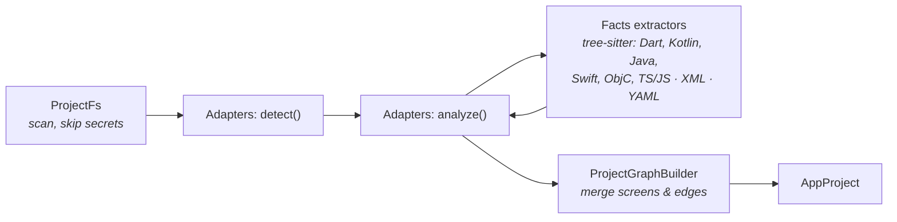

# Analysis adapters

AppFlow Explorer analyzes projects with a platform-independent core and one adapter per platform or framework. Each adapter states what it can discover and how far each kind of result can be trusted. Patterns it cannot follow are reported as warnings and unresolved navigation; nothing is invented.

## How analysis works



1. **Scan.** [`ProjectFs`](../packages/analyzer/src/fs/projectFs.ts) lists files. It skips dependency and build folders and symlinks, and lists sensitive files as excluded without reading them.
2. **Detect.** Each adapter returns matches from metadata files (`pubspec.yaml`, `AndroidManifest.xml` + Gradle, `*.xcodeproj`, `package.json`). An `android/` or `ios/` folder inside a Flutter or React Native app becomes a `host` match.
3. **Parse.** Code files are parsed with tree-sitter grammars (WASM). Language extractors turn syntax trees into language-neutral **facts**: classes, functions, calls with arguments, handlers (`onPressed`, `setOnClickListener`, `@IBAction`, …), JSX elements, imports, string constants, variables and map pairs. See [`parsing/facts.ts`](../packages/analyzer/src/parsing/facts.ts). XML (manifests, nav graphs, layouts, storyboards) uses a position-aware parser, so every result keeps its line number.
4. **Analyze.** Adapters reason over facts and configuration, and report entities to the [`ProjectGraphBuilder`](../packages/analyzer/src/core/builder.ts). The builder merges duplicates, so a nav-graph action and the code that triggers it become **one** edge with two pieces of evidence.
5. **Assemble.** The [engine](../packages/analyzer/src/core/engine.ts) adds file metadata and modules, plus a run report for each adapter (`complete`, `partial`, `failed`).

## Evidence and status

| Evidence `source` | Meaning | Edge status | Canvas |
| --- | --- | --- | --- |
| `runtime` | Observed in the running app (Phase 3) | `verified` | solid blue |
| `declared` | Explicit configuration: route tables, nav-graph actions, storyboard segues, tab navigators, file routes | `declared` | solid violet |
| `static` | Found in code: a `navigate(…)`, `push(…)` or `startActivity(…)` call | `inferred` | dashed slate |
| — | Destination unknown (`to: null`), with `unresolvedKind` set to `dynamic`, `missing-target` or `unsupported` | `unresolved` | dotted amber, with a “?” node |

The status is derived from the evidence and never stored, so static analysis alone can never produce `verified`. Evidence also carries a `confidence`: `high` for explicit configuration or literal targets, `medium` for resolved common patterns, `low` for heuristics and dynamic values.

## Supported project types

### Flutter / Dart — `flutterAdapter`

| Discovers | Confidence |
| --- | --- |
| Packages from every `pubspec.yaml` (app + nested packages), dependencies | high |
| `MaterialApp` / `CupertinoApp` `routes` tables, inline or via a top-level map, with keys resolved through constants (`Routes.home`) | high |
| go_router `GoRoute` paths (nested paths joined), names, `initialLocation` | high |
| AutoRoute config: `AutoRoute` / `CustomRoute` / custom route subclasses with paths, nested `children` (tabs under `AutoTabsScaffold` / `AutoTabsRouter`), `initial`, `PageInfo` getters and generated `*.gr.dart` route classes | high |
| AutoRoute navigation: `context.router.push` / `replace` / `replaceAll` / `pushAndPopUntil`, `context.pushRoute`, router callbacks passed to pages | high |
| Screens: route targets, `Navigator.push` targets, dialog/sheet builders; other widgets that build a `Scaffold` | high / medium |
| `Navigator.pushNamed` / `push` / replacement / remove-until; `context.go` / `push` / `goNamed` | medium |
| `showDialog` / `showModalBottomSheet` and Cupertino variants with a widget-class builder | medium |
| Handlers and labels (`onPressed` of an `ElevatedButton` showing “Sign in”) | medium |
| Assets declared in `pubspec.yaml` and string references to them | high |

Limitations: `onGenerateRoute` functions are not evaluated. Interpolated or variable route names are unresolved. GetX, Beamer and Fluro are reported as unsupported. Inline `AlertDialog`s are not separate screens. A private Scaffold widget wrapped by a route page (`LoginPage` → `_LoginPage`) is shown as part of that page.

### Android — `androidAdapter`

| Discovers | Confidence |
| --- | --- |
| Gradle modules with a manifest; dependencies from `build.gradle.kts` (parsed) and `build.gradle` (line-based) | high / medium |
| Activities from `AndroidManifest.xml` (launcher = entry point), Activity and Fragment subclasses, DialogFragment and BottomSheetDialogFragment | high |
| Navigation-component graphs: destinations, nested graphs, actions (declared), start destination hosted via `app:navGraph` | high |
| `navigate(R.id.action_…)` and Safe Args `XDirections.actionY()` matched to graph actions | high |
| `startActivity(Intent(this, X::class.java))`, Java `X.class`, local `val intent = …` | medium |
| `FragmentTransaction.replace/add`, `DialogFragment.show` | medium |
| Compose `NavHost` `composable` / `dialog` routes (constants and `{param}` patterns), `navController.navigate("…")` | medium |
| Layout views with ids (via `setContentView`, `inflate`, ViewBinding), Compose UI calls, resources and `@drawable` / `R.drawable` references | medium / high |

Limitations: implicit intents are counted, not drawn. Type-safe Compose routes and deep links are unsupported. Intents built in other classes are not followed.

### iOS — `iosAdapter`

| Discovers | Confidence |
| --- | --- |
| `.xcodeproj` projects and Swift packages; SPM pins (`Package.resolved`) and Podfile pods | high / medium |
| Storyboard scenes (with or without custom class), segues (declared), navigation and tab-bar containers resolved to their content | high |
| Entry point from `UIMainStoryboardFile`, or `@main App` `WindowGroup` | high |
| `UIViewController` subclasses (Swift and Objective-C) | high |
| `pushViewController` / `present` / `show`, `instantiateViewController(withIdentifier:)`, `performSegue` matched to segues | medium / high |
| SwiftUI `NavigationLink`, `navigationDestination`, `sheet` / `fullScreenCover` / `popover`, `TabView`, `UIHostingController(rootView:)` | medium |
| Storyboard views, XIB-backed cells, SwiftUI controls; `.xcassets` image sets and their references | medium / high |

Limitations: Objective-C support covers class declarations and `alloc/init` / `new` pushes only. Coordinators are followed one level through component usage. System controllers (alerts, share sheets) are counted, not drawn.

### React Native — `reactNativeAdapter`

| Discovers | Confidence |
| --- | --- |
| App from `package.json` (Expo or bare); `android/` and `ios/` analyzed as host modules | high |
| React Navigation `<X.Screen name component>` and static `screens: {}` config, resolved through imports to the component definition | high |
| Nested navigators: a route that renders another navigator lands on that navigator's initial screen; tab siblings (declared) | high |
| `navigation.navigate` / `push` / `replace` / `reset` / `jumpTo` with literal or constant route names | medium |
| Expo Router file routes (`app/`, groups, `[param]`), `router.push`, `<Link href>` | high / medium |
| Native modules (`ReactContextBaseJavaModule`, `RCT_EXPORT_MODULE`), `require()`'d images | medium / high |

Limitations: route names computed at runtime are unresolved. Wix React Native Navigation, React Router Native and router-flux are unsupported. Linking configs are not analyzed.

## UI states and deep links

Besides screens and navigation, every analysis reports two things that show how a screen behaves.

**UI states found in code** (`screen.discoveredStates`) are loading, empty, error, data loading, authentication, dialog, bottom-sheet and tab states. Each adapter declares *patterns* in `uiStateRules` (see [`adapters/uiStateRules.ts`](../packages/analyzer/src/adapters/uiStateRules.ts)). Matching is shared and framework-independent, in [`core/uiStates.ts`](../packages/analyzer/src/core/uiStates.ts):

- Only the screen's own code is searched: its class or function, plus companion classes such as a Flutter `State<HomeScreen>`.
- Comments and class declarations are skipped, so `class X extends DialogFragment` is not reported as a dialog state.
- Only the first match of each kind is kept, with its file, line and confidence.
- A dialog or sheet that is already drawn as a connection from the same call is not reported again.

These are patterns in code, not observed screens. They are shown separately from runtime captures, as "UI states in code" in the details panel and as a "◐ N" badge on the node.

**Deep links** (`project.deepLinks`) are collected from `AndroidManifest.xml` intent filters, `Info.plist` URL types and `*.entitlements` associated domains. A link points to a screen only when its path matches a declared route (`routeForPath`). A link that is routed at runtime keeps `screenId: null` and gets a reason. There is no guessing.

**Supporting another framework.** A new adapter only adds its own list of rules. The canvas, graph, reports and exports read `discoveredStates` and `deepLinks` from the model, so they need no changes.

## Warning codes

| Code | Severity | Meaning |
| --- | --- | --- |
| `sensitive-files-excluded` | info | Files that may hold secrets were skipped and never read |
| `unsupported-project` | warning | No adapter matched; only the file tree is available |
| `unsupported-router`, `unsupported-route-generator`, `unsupported-navigation` | warning | A routing system or construct is not analyzed |
| `unresolved-route-key`, `unresolved-route-table` | warning | A route name or table could not be resolved to a value |
| `route-target-unknown`, `destination-source-missing`, `activity-source-missing`, `class-source-missing` | info / warning | Configuration points to something whose source was not found |
| `navigation-outside-screen` | info | A navigation call could not be attributed to any screen |
| `inline-dialog`, `implicit-intent`, `system-controllers`, `host-activity`, `host-module` | info | Recognized, but intentionally not drawn |
| `missing-asset`, `undeclared-asset` | warning | Asset declarations and references disagree |
| `parse-errors`, `parse-failed`, `xml-parse-failed`, `file-too-large` | info / warning | A file could only be partially analyzed |
| `adapter-failed`, `detection-failed` | error | An adapter crashed; the others still ran |

## Adding an adapter

New platforms and routing frameworks plug in **without changing the model or the frontend**.

1. **Create** `packages/analyzer/src/adapters/<name>/index.ts` exporting an `AnalysisAdapter`:

   ```ts
   import type { AnalysisAdapter } from '../../core/types';

   export const myAdapter: AnalysisAdapter = {
     id: 'my-platform',
     name: 'My Platform',
     platform: 'android', // or extend PlatformId in packages/model first
     capabilities: [{ kind: 'screens', description: 'What exactly is found, from where', confidence: 'high' }],
     limitations: [{ description: 'What is not analyzed' }],
     async detect(ctx) {
       // Look at ctx.files / ctx.readText(); return [] when the project is not yours.
       return [];
     },
     async analyze(ctx, match, out) {
       // ctx.facts(path) → parsed facts (cached); ctx.warn(...); ctx.progress(...)
       // out.addModule / addScreen / addRoute / addEdge / addAsset
     },
   };
   ```

2. **Reuse the facts.** `ctx.facts(path)` already supports Dart, Kotlin, Java, Swift, Objective-C, TypeScript and JavaScript. `CodeIndex` gives class lookup, inheritance (`extendsAny`), constant resolution (`resolveString`) and component ownership (`ownersUsing`). Helpers in [`adapters/shared.ts`](../packages/analyzer/src/adapters/shared.ts) build triggers and evidence.
3. **A new language** needs a grammar and an extractor: add the `.wasm` grammar id in [`parsing/treeSitter.ts`](../packages/analyzer/src/parsing/treeSitter.ts), and add an `extractors/<lang>.ts` that fills `FileFacts`. Add the extension in [`parsing/index.ts`](../packages/analyzer/src/parsing/index.ts).
4. **A new routing framework** for an existing platform belongs in that adapter's folder as its own module (see [`flutter/goRouter.ts`](../packages/analyzer/src/adapters/flutter/goRouter.ts)). If it is not supported yet, report its calls as unresolved edges with `unresolvedKind: 'unsupported'`.
5. **Be honest about evidence.** Configuration → `declaredEvidence`. Code → `staticEvidence` with a confidence. Unknown target → `to: null` plus a reason. Never pick a likely target without evidence.
6. **Register** the adapter in [`adapters/index.ts`](../packages/analyzer/src/adapters/index.ts).
7. **Add a fixture** under `packages/analyzer/fixtures/` covering common patterns, a nested module, an unresolved route and an unsupported construct. Add a `<name>.test.ts` next to the adapter that asserts screens, routes, edge statuses and warnings, then run `npm test`.

## Fixtures

| Fixture | Covers |
| --- | --- |
| `flutter_shop` | Routes table via constants, `pushNamed` / `push` / replacement / remove-until, dialogs and sheets, nested `ui_kit` package, dynamic and undeclared routes, `onUnknownRoute`, inline dialog, assets, Flutter host `android/` and `ios/`, secrets |
| `flutter_auto_route` | AutoRoute config with nested tab routes, `PageInfo` getter, sheet and dialog routes, generated `.gr.dart`, wrapper pages, two same-named `BodyContent` widgets, undeclared and runtime routes |
| `flutter_go_router` | Nested GoRoutes, named routes, interpolated locations, unknown and dynamic locations |
| `android_tasky` | Manifest activities (incl. missing source), nav graph with nested graph and pop-up-to, Safe Args, Kotlin and Java intents, fragment transactions, DialogFragment, Compose NavHost in a feature module, implicit intent, layouts and resources, secrets |
| `ios_bookshelf` | Storyboard with navigation controllers, segues and identifier-instantiated scenes, UIKit ↔ SwiftUI hosting, NavigationLink and sheet, Objective-C, XIB, `.xcassets`, SPM, unknown segue, secrets |
| `flutter_states` | Loading, empty, error, data, authentication, bottom sheet and tab states, an inline dialog, a commented-out state, Android app links and a custom scheme, iOS URL types and associated domains |
| `rn_recipebox` | Stack and tab navigators (nested), modal group, route constants, `reset`, dynamic and undeclared routes, native modules in `android/` and `ios/`, `require()` images, secrets |
