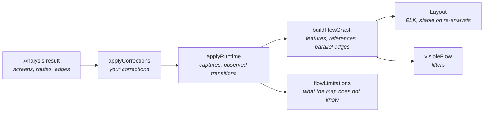

# App Flow Map

The App Flow Map is generated from two sources: static analysis and runtime observations. It shows screens and their UI states, and the navigation between them. Each connection says where it comes from. When analysis cannot determine something, the map says so. It never fills the gap with a guess.

- Model: [`packages/model/src/flow.ts`](../packages/model/src/flow.ts), [`graph.ts`](../packages/model/src/graph.ts)
- Layout: [`apps/desktop/src/renderer/src/canvas/layout.ts`](../apps/desktop/src/renderer/src/canvas/layout.ts)
- State: [`apps/desktop/src/renderer/src/store/explorerStore.ts`](../apps/desktop/src/renderer/src/store/explorerStore.ts)

## How the map is built

Each step is a pure function and never modifies the analysis result. The steps run again after every re-analysis, correction or new capture.

## Nodes

| Node | Meaning |
| --- | --- |
| Screen | A page, dialog or bottom sheet found by analysis. Dialogs and sheets have a dashed frame and a label. A screen with several UI states (for example several runtime captures) has a ‹ 1/3 › switcher. A screen with no capture shows a wireframe built from code. |
| Unknown destination | A navigation call whose destination could not be determined, with the reason. It is never connected to a guessed screen. |
| Shared destination (↪ Login) | A screen reached from many screens (4 or more by default) is drawn once. Its other incoming connections point to small references placed next to their sources. Clicking a reference jumps to the screen. The line from the screen closest to a start screen stays real. Turn this off with **Filters → Draw shared destinations once**. |
| Feature box | A dashed box around the screens of one feature that has at least two screens. Drag its title to move the whole feature. |

### Features

A screen's feature comes from the folder of its file:

| Path | Feature |
| --- | --- |
| `lib/features/auth/login_screen.dart` | auth (folder after `features`, `pages`, `screens`, `modules`, `presentation`, …) |
| `lib/src/pages/voucher/voucher_list/voucher_list_page.dart` | voucher |
| `lib/src/pages/qr_scan/dialog/earn_point_success.dart` | qr_scan (the feature folder comes first) |
| `lib/src/dialog/map/dialog_map_page.dart` | dialogs (a shared folder of dialogs) |
| `lib/src/bottom_sheets/…` | bottom sheets |
| `lib/src/widgets/…` | shared |
| `app/src/main/java/com/example/tasky/profile/ProfileFragment.kt` | profile (closest meaningful folder) |

To move a screen to another feature, set it in **Screen details → Correct the map → Feature group**.

## Connections and where they come from

| Status | Line | Meaning |
| --- | --- | --- |
| Verified | solid blue | Observed in the running app (Phase 3). This includes observed-only connections, labelled "Observed at runtime", when analysis found no code path for them. Their trigger is unknown. |
| Set by you | teal, dash-dot | You added the connection or chose its destination. It is not verified unless it is observed. |
| Declared | solid violet | Declared in navigation configuration (routes table, nav graph, storyboard segue). |
| Inferred | dashed grey-blue | Found by static analysis of code only. |
| Unresolved | dotted amber | The destination is unknown. |

Status is derived from evidence, in the order runtime, manual, declared, static. The Evidence section of each connection lists every source with its confidence and location.

When several connections link the same two screens (different actions, or both directions), each is drawn separately with its own label.

An observed transition that matches **several** connections verifies none of them. The map reports it as a limitation.

## Working with the map

| Action | How |
| --- | --- |
| Fit, zoom, pan | **Fit** button, the zoom control, trackpad or scroll to pan, pinch or Ctrl+scroll to zoom |
| Move | Drag a screen, or drag a feature box by its title. Moved positions are saved and survive re-analysis and restarts. |
| Re-arrange | **Auto layout** recomputes everything and forgets manual positions |
| Select | Click a screen or a connection. Related elements are highlighted and the rest dimmed. Double-click opens the code. |
| Filter | **Filters**: connection status, screen kind (pages, dialogs, sheets), features, and hiding screens left without visible connections. Filters only hide elements, they never re-arrange the map. |
| Arrange | **Filters → Arrangement**: group by feature, draw shared destinations once |
| What the map does not know | The panel at the bottom lists: partial or failed adapters, unknown destinations, flows not observed at runtime, flows set by hand, observed-only transitions, ambiguous observations, screens with no incoming navigation, analysis warnings, connections you hid, corrections that no longer match, and what the filters hide. Click an item to show it. |

## Manual corrections

| Correction | Where | Effect |
| --- | --- | --- |
| Mark as incorrect | Connection → Correct the map | The connection is hidden and listed in **Overview → Your corrections**, where it can be restored |
| Set a destination | An unknown destination → Correct the map | The connection points to the chosen screen with status *Set by you* |
| Add a connection | Screen → Correct the map | A new connection with your label and kind, status *Set by you*. Deleting it removes it. |
| Change a feature | Screen → Correct the map → Feature group | The screen moves to that feature box |

Corrections are stored on this computer, per project, separately from the analysis result. They are re-applied after every re-analysis:

- Connections are matched by their id (`from->to:kind`), which does not depend on line numbers.
- Unknown destinations are matched by screen, file, handler and label, so they still match when the call moves to another line.
- A correction that no longer matches anything is kept but has no effect. The map reports it.

## Layout

- **Automatic layout.** ELK layered, left to right, with start screens first. Feature boxes use ELK compound layout so each feature stays together. Input is sorted, so the same graph always produces the same picture.
- **Re-analysis.** Every screen that still exists stays exactly where it was, whether it was placed by hand or automatically. A new screen is placed next to a screen it connects to, then pushed down until it overlaps nothing. Screens that no longer exist are dropped.
- **Overlaps.** Positions you moved by hand are fixed. Other nodes are moved until they no longer overlap.

## Reports, export and keeping the map current

- **Analysis report** (button **Report**, or `C`). It shows:
  - coverage: screens, how many are reachable from a start screen, how many have UI states in code or runtime captures, connections by status, resolved deep links, and source files with findings;
  - every unresolved connection, grouped by cause (dynamic, missing target, unsupported, unknown). Clicking one selects it on the map and opens its code;
  - screens that cannot be reached from a start screen;
  - every deep link.

  The report lists counts of real items. There is no overall score.
- **Export** (button **Export**, or `Ctrl/⌘ E`). Four formats:
  - JSON (`appflow-map/1`): screens, connections, states, deep links, coverage and canvas positions;
  - Markdown report;
  - Mermaid flowchart;
  - SVG of the map as it is arranged on the canvas.

  Exports never contain file contents or the project's absolute path. You choose the file in a native save dialog. The main process accepts only the four known extensions and at most 64 MB.
- **Source changes.** While a project is open, the app asks the agent every 15 seconds whether files changed since the analysis. It asks only while the window is visible, and again when the window gains focus. A banner lists what changed and offers **Re-analyze**. Re-analysis keeps the layout and your corrections (see above).
- **Session.** The app stores the last project, plus each project's selection, filters and viewport, in local storage on this machine (`appflow:session:v1`). Reopening the project restores them. A selection that no longer exists is dropped. **Forget** on the welcome screen removes the last project.
- **Large projects.** Above 120 nodes, the canvas renders only the elements in view. The minimap can be hidden (`M`).

## Keyboard and accessibility

| Keys | Action |
| --- | --- |
| `Ctrl/⌘ K` | Command palette |
| `?` | Shortcut help |
| `Ctrl/⌘ E` | Export |
| `Shift R` | Re-analyze |
| `C` | Analysis report |
| `N` | Next unresolved connection |
| `O` | Open the selection's code |
| `F` / `=` / `-` | Fit, zoom in, zoom out |
| `M` | Show or hide the minimap |
| `Ctrl/⌘ B` / `Ctrl/⌘ Shift B` | Files panel / details panel |
| `Esc` | Close a dialog, then clear the selection |

The shortcut help is generated from the same table the app uses to handle keys ([`lib/shortcuts.ts`](../apps/desktop/src/renderer/src/lib/shortcuts.ts)). Single-key shortcuts are off while you type in a field.

Accessibility:

- Dialogs keep focus inside while they are open, close with `Esc`, and return focus to where it was.
- Panels are `nav`, `main` and `aside` landmarks.
- Icon buttons have labels.
- The source-changes banner is a live `status` region.
- Animations are turned off when the system asks for reduced motion.

## Tests

| File | Covers |
| --- | --- |
| `packages/model/src/flow.test.ts` | Graph construction (nodes, branches, dialogs, parallel edges, shared destinations, feature boxes, order independence), edge provenance, corrections (hide, resolve, add, line moves, stale), filters, limitations |
| `packages/model/src/graph.test.ts` | Runtime overlay: single match verifies, ambiguous verifies nothing, no match adds an observed-only edge, idempotent |
| `apps/desktop/src/renderer/src/canvas/layout.test.ts` | Every node placed, no overlaps, start screen first, features kept apart, deterministic layout, overlap resolution, stability after re-analysis |
| `packages/model/src/report.test.ts` | Coverage, unresolved report, JSON/Markdown/Mermaid/SVG export without absolute paths |
| `packages/agent/src/e2e.test.ts` | End to end over HTTP: analyze `flutter_states`, UI states and deep links, reports, every export format, edit a file, see it in `/changes`, re-analyze |
| `apps/desktop/src/renderer/src/lib/shortcuts.test.ts` | Shortcut matching, typing in fields, modifiers |
| `apps/desktop/src/renderer/src/components/Phase6Panels.test.tsx` | Report panel, shortcut help, source-changes banner |
| `apps/desktop/src/renderer/src/store/explorerStore.test.ts` | Session restore and malformed sessions, source changes, export, minimap without re-layout. Re-analysis re-applies corrections and keeps positions, corrections persist across sessions, stale corrections, filters do not re-layout, observed-only edges |
