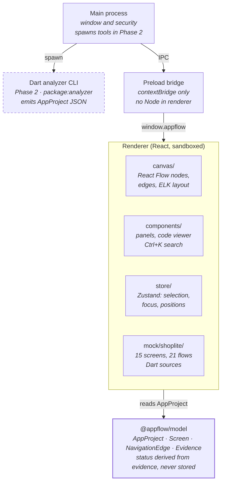

# AppFlow Explorer — Báo cáo Phase 1

20/10/2026

## Tổng quan & phạm vi

Phase 1 đã hoàn thành ngày 20/10/2026: AppFlow Explorer chạy được như một ứng dụng desktop, hiển thị bản đồ màn hình và luồng điều hướng của một app Flutter trên canvas vô hạn, dùng dữ liệu mẫu. Giao diện bám theo mockup tham chiếu [`docs/mockup.png`](mockup.png).

Mục tiêu của Phase 1 là dựng nền sản phẩm và trải nghiệm chính trước khi có phân tích thật, để các phase sau chỉ cần đổ dữ liệu vào một mô hình đã có sẵn.

**Trong phạm vi:** canvas (pan, zoom, minimap, fit), node màn hình trong khung điện thoại, mũi tên điều hướng, chọn và làm mờ phần không liên quan, kéo thả và tự bố cục, sidebar cây file, panel chi tiết, xem code tới đúng dòng, tìm kiếm Ctrl+K, test cho các phần lõi.

**Ngoài phạm vi:** đọc dự án Flutter thật, chạy emulator và chụp màn hình thật, local agent, backend. Toàn bộ dữ liệu hiện là dữ liệu mẫu và được gắn nhãn rõ ràng trong giao diện.

## Quyết định công nghệ

Sản phẩm được làm thành ứng dụng desktop bằng **Electron + React + TypeScript**. Lý do: tool cần đọc file trên máy và chạy `dart`, `flutter`, `adb` cục bộ, không upload source code đi đâu.

| Lựa chọn | Canvas vô hạn | Phần chạy trên máy | Bản cài | Kết luận |
| --- | --- | --- | --- | --- |
| Electron + React | React Flow có sẵn pan, zoom, minimap, mũi tên | Node.js gọi dart/flutter/adb dễ | ~100–150 MB | **Đã chọn** |
| Tauri 2 + React | Như Electron | Viết bằng Rust, cần thêm toolchain | ~10–20 MB | Không chọn |
| Flutter Desktop | Phải tự xây canvas, mũi tên, minimap | Dart | ~30–50 MB | Không chọn |

Các thư viện chính:

- **React Flow (`@xyflow/react`)**: canvas, node, edge, minimap.
- **elkjs**: tự bố cục theo luồng từ trái sang phải.
- **Zustand**: state chung, đồng bộ việc chọn giữa canvas và các panel.
- **Tailwind CSS v4**: design tokens cho giao diện tối.
- **highlight.js**: tô màu cú pháp Dart trong code viewer.
- **cmdk + Fuse.js**: bảng tìm kiếm Ctrl+K, tìm gần đúng.
- **Vitest + Testing Library**: unit test và component test.

Phần phân tích code Flutter (Phase 2) sẽ là một Dart CLI nhỏ dùng `package:analyzer`, được Electron gọi tới.

## Kiến trúc & cấu trúc repo

Repo là một monorepo dùng npm workspaces gồm hai package: `apps/desktop` (ứng dụng Electron) và `packages/model` (data model dùng chung). Giao diện không được truy cập Node; mọi thao tác với máy sẽ đi qua main process.



Hộp nét đứt là phần của Phase 2. Khi có, Dart CLI sẽ xuất ra cùng kiểu `AppProject` mà dữ liệu mẫu đang xuất, nên renderer không phải đổi.

```
apps/desktop/
  src/main/              cửa sổ, cấu hình bảo mật
  src/preload/           bridge hẹp, có kiểu, lộ ra cho renderer
  src/renderer/src/
    canvas/              node điện thoại, mũi tên, auto layout ELK
    components/          top bar, cây file, panel chi tiết, code viewer, Ctrl+K
    store/               state: lựa chọn, focus, code đang mở, layout
    search/              chỉ mục tìm kiếm
    mock/shoplite/       dữ liệu mẫu Phase 1
packages/model/          data model chuẩn hoá
```

## Data model chuẩn hoá

Mọi nguồn dữ liệu đều xuất ra cùng một kiểu `AppProject` trong package `@appflow/model`: hôm nay là dữ liệu mẫu, sau này là static analyzer và runtime explorer. Giao diện chỉ đọc kiểu này, nên khi thay nguồn dữ liệu thì không phải sửa UI.

| Kiểu | Nội dung chính |
| --- | --- |
| `AppProject` | id, tên, framework, nguồn (`mock` hoặc `analysis`), danh sách files, screens, edges |
| `SourceFile` | đường dẫn tương đối, ngôn ngữ, nội dung (nếu có) |
| `SourceLocation` | file, dòng, cột, dòng kết thúc |
| `Screen` | tên, loại (page, dialog, bottomSheet), route, widget class, vị trí code, có phải màn bắt đầu, key widgets, các UI state |
| `ScreenState` | nhãn, ảnh chụp, `provenance` (`runtime` hoặc `mock`) |
| `NavigationEdge` | từ màn nào, tới màn nào (`null` nếu không xác định được), loại (push, replace, reset, pop, modal, tab), trigger, danh sách bằng chứng |
| `Evidence` | nguồn (`static` hoặc `runtime`), mô tả, vị trí code, thời điểm quan sát |

Ba quy tắc giữ cho dữ liệu trung thực:

1. **Trạng thái của edge được tính từ bằng chứng, không gán tay.** Có bằng chứng runtime là `verified`; chỉ có bằng chứng static là `inferred`; không rõ đích hoặc không có bằng chứng là `unresolved`. Một luồng chỉ suy ra từ code vì vậy không thể hiển thị là đã xác minh.
2. **Ảnh preview luôn ghi rõ nguồn gốc.** Ảnh minh hoạ có `provenance: mock` và hiện nhãn "Mock preview", không bao giờ được trình bày như ảnh chụp thật.
3. **Vị trí trên canvas lưu riêng với dữ liệu phân tích.** Màn hình do người dùng kéo tay được giữ nguyên khi phân tích lại hoặc tự bố cục, trừ khi người dùng bấm Auto layout.

Hàm `validateProject` báo các lỗi toàn vẹn như edge trỏ tới màn hình không tồn tại, vị trí code trỏ tới file không tồn tại, hoặc id bị trùng.

## Tính năng đã hoàn thành

Tất cả mục tiêu giao diện của Phase 1 đã chạy được trên dữ liệu mẫu ShopLite, gồm 15 màn hình, 21 luồng điều hướng và 26 file.

| Khu vực | Đã làm được |
| --- | --- |
| Canvas | Pan (cuộn, Space + kéo), zoom (Ctrl + cuộn, nút ±, về 100%), minimap, nút Fit, nền chấm |
| Node màn hình | Khung điện thoại kèm ảnh preview; tên widget và route nằm dưới khung; viền xanh lá cho màn bắt đầu, xanh dương khi đang chọn; viền nét đứt cho dialog và bottom sheet; ô giữ chỗ "No capture yet" cho màn chưa có ảnh |
| Mũi tên | Đường gấp góc có nhãn ngắn; 3 kiểu nét theo trạng thái; node "Unknown destination" cho luồng không rõ đích; nhãn tự ẩn khi zoom dưới 38% |
| Chọn & làm mờ | Chọn màn hình hoặc mũi tên thì mọi phần không liên quan mờ xuống 28%; Esc để bỏ chọn |
| Bố cục | Tự bố cục bằng ELK, màn bắt đầu luôn ở cột đầu; kéo thả và nhớ vị trí theo từng dự án; Auto layout để xếp lại |
| Sidebar trái | Cây file có ô lọc; số màn hình được khai báo trong mỗi file; bấm file sẽ mở code và làm nổi các màn hình liên quan; thẻ trạng thái phân tích |
| Panel phải | Tổng quan dự án (số liệu, độ tin cậy, mục cần chú ý); chi tiết màn hình (ảnh preview, Navigation from/to, file, key widgets); chi tiết luồng (trigger, handler, bằng chứng, cảnh báo "not verified") |
| Xem code | Mở đúng dòng bằng nút Open in Code Editor hoặc double-click; tô màu Dart, YAML, Markdown; số dòng và vạch đánh dấu; tự đổi theo màn hình đang chọn khi panel đang mở |
| Tìm kiếm | Ctrl+K tìm màn hình, route, file, widget và luồng điều hướng; chọn kết quả thì canvas zoom tới và mở code |
| Bảo mật | Renderer chạy sandbox, bật context isolation, không truy cập Node; preload chỉ lộ thông tin môi trường; có CSP; chặn chuyển trang và cửa sổ mới |

**Dữ liệu mẫu ShopLite** là một app mua sắm giả với source Dart viết sẵn. Vị trí của màn hình và của lệnh điều hướng được tính bằng cách tìm đoạn code tương ứng, nên code viewer luôn mở đúng dòng. Bộ dữ liệu cố ý có đủ 3 trạng thái (10 verified, 10 inferred, 1 unresolved) và một màn chưa có ảnh (PaymentFailedDialog).

## Đối chiếu với mockup

Bố cục và phong cách đã khớp với mockup; có ba chỗ khác và cả ba đều có chủ đích.

**Đã khớp:** nền navy tối có chấm; top bar có logo, badge Beta, tên dự án, badge Flutter, tab Flow Map và ô search bên phải; sidebar "Project Files" có thẻ trạng thái ở dưới; canvas có tiêu đề "App Flow Map", legend và zoom ở góc trên bên phải; mũi tên gấp góc có nhãn; panel "Screen Details" có ảnh preview, Navigation from/to, Associated file, Key widgets và nút "Open in Code Editor".

| Chỗ khác | Mockup | Bản hiện tại | Lý do |
| --- | --- | --- | --- |
| Nét đứt | Nghĩa là "Modal" | Nghĩa là "Inferred"; edge modal có nhãn "modal" riêng | Yêu cầu bắt buộc tách luồng đã xác minh với luồng chỉ suy ra từ code |
| Tab Screens, Code, Insights | Có | Không làm | Chưa có chức năng; tránh nút bấm không làm gì |
| Nút Re-analyze, Import project | Bấm được | Để mờ, ghi chú "Phase 2" | Chưa có phân tích thật |

Ngoài ra, top bar và thẻ trạng thái luôn hiện "Mock data", để không ai nhầm dữ liệu mẫu với kết quả phân tích thật.

## Kiểm thử & xác minh

Cả 26 test đều pass, typecheck sạch và bản build production thành công. App cũng đã được chạy thật và kiểm tra bằng ảnh chụp màn hình.

| Bộ test | Số test | Kiểm tra điều gì |
| --- | --- | --- |
| `packages/model` — graph | 7 | Quy tắc tính trạng thái edge; chỉ mục incoming/outgoing; phát hiện tham chiếu hỏng và id trùng |
| Dữ liệu mẫu ShopLite | 4 | Dữ liệu nhất quán; có đủ 3 trạng thái; vị trí màn hình trỏ đúng dòng khai báo class; ảnh mock không bị ghi là runtime |
| Auto layout | 3 | Mọi node đều có vị trí và không chồng lên nhau; màn bắt đầu ở cột đầu; vị trí kéo tay được giữ |
| Tìm kiếm | 6 | Tìm theo tên, route, file, widget kèm vị trí, luồng kèm trạng thái |
| Cây file | 2 | Lồng thư mục và sắp xếp; lọc vẫn giữ thư mục cha |
| Panel chi tiết | 4 | Luồng chỉ có bằng chứng static hiện "not verified" và không bao giờ hiện "Verified at runtime"; nút mở code đúng file |

Các luồng đã kiểm tra trên app thật:

- Mở app: cây file, 15 khung điện thoại được tự bố cục và fit vào màn hình, minimap, panel tổng quan.
- Chọn và double-click màn Home: các phần không liên quan mờ xuống 0.28; code mở tại dòng `class HomeScreen`.
- Ctrl+K → "Place order" → luồng Checkout → Order Success: canvas zoom tới, panel hiện cảnh báo "not verified", code mở tại dòng 20 (`pushReplacementNamed`).
- Ctrl+K → "cart": panel Screen Details hiện đủ các mục như mockup.

## Hạn chế & bước tiếp theo

Bước tiếp theo là Phase 2: đọc một dự án Flutter thật bằng Dart analyzer và đổ kết quả vào data model đã có.

**Hạn chế đã biết:**

- Mũi tên đôi khi đi xuyên qua khung điện thoại, vì chưa dùng đường đi né vật cản mà ELK tính sẵn.
- Gói renderer nặng khoảng 3,8 MB, chủ yếu do elkjs (1,6 MB). Với app desktop thì chấp nhận được; có thể chuyển ELK sang web worker sau.
- Vị trí kéo tay đang lưu trong local storage của renderer; khi có dự án thật nên chuyển vào workspace của dự án.
- Chưa có test end-to-end tự động (Playwright) cho canvas; các luồng trên mới được kiểm tra bằng script chụp màn hình.

**Phase 2 dự kiến gồm:**

- [ ] Dart CLI dùng `package:analyzer` để tìm file, route, màn hình, widget, asset và các lệnh điều hướng.
- [ ] IPC hẹp qua preload để chọn thư mục dự án và chạy phân tích, có hỏi ý kiến người dùng trước khi chạy bất kỳ script nào.
- [ ] Bật nút Import project và Re-analyze; hiển thị trạng thái và lỗi phân tích.
- [ ] Bảo vệ file `.env`, khoá ký và secrets của dự án được phân tích.

**Cách chạy:** `npm install`, sau đó `npm run dev` để mở app, `npm test` để chạy test, `npm run build` để build. Nếu báo `Cannot find module 'electron'` thì hãy bỏ biến môi trường `ELECTRON_RUN_AS_NODE` (VS Code hay đặt biến này). Nếu thiếu file chạy Electron thì chạy `node node_modules/electron/install.js`.
