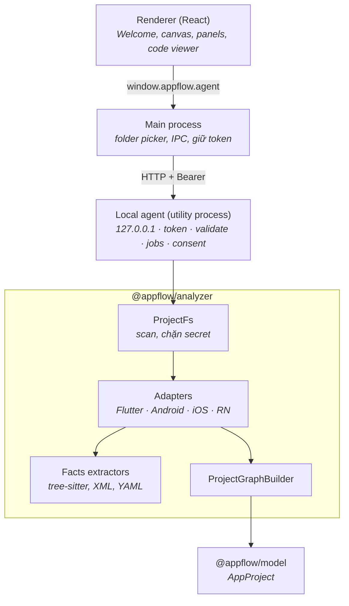

# AppFlow Explorer — Báo cáo Phase 2

20/10/2026

## Tổng quan & phạm vi

Phase 2 hoàn thành ngày 20/10/2026. AppFlow Explorer giờ mở được dự án Flutter, Android, iOS và React Native thật, phân tích tĩnh trên máy qua một local agent, rồi vẽ màn hình, route và luồng điều hướng lên canvas của Phase 1.

**Trong phạm vi:**

- Chọn thư mục dự án và nhận diện loại dự án.
- Phân tích tĩnh bằng parser theo ngôn ngữ, với các adapter riêng cho từng nền tảng.
- Data model mở rộng.
- Local agent kèm API.
- Tích hợp vào app desktop.
- Fixture, test và tài liệu.

**Ngoài phạm vi:** chạy emulator và chụp màn hình thật (Phase 3), tức là chưa có bằng chứng `runtime`. Vì vậy chưa luồng nào được đánh dấu `verified`.

## Quyết định kỹ thuật

| Quyết định | Lựa chọn | Lý do |
| --- | --- | --- |
| Parser | **tree-sitter** (WASM) cho Dart, Kotlin, Java, Swift, Objective-C, TypeScript, JavaScript; parser XML có số dòng; thư viện `yaml` | Một cơ chế cho mọi nền tảng, không cần cài SDK, không chạy `pub get` hay bất kỳ code nào của dự án |
| Thay đổi so với kế hoạch Phase 1 | Bỏ Dart CLI dùng `package:analyzer` | Cái giá: phân tích dựa trên cú pháp, không có thông tin kiểu như compiler |
| Lớp trung gian | Bộ trích xuất theo ngôn ngữ → **facts** chung (class, call, tham số, handler, JSX, import, hằng số, biến) | Logic adapter không phụ thuộc vào cây cú pháp, nên dùng chung được giữa các ngôn ngữ |
| Local agent | HTTP API chỉ nghe ở `127.0.0.1`, chạy trong utility process riêng của Electron | Phân tích nặng không làm treo app; cùng một API dùng được cho bản web sau này |
| Kênh renderer ↔ agent | IPC qua main process, token chỉ nằm ở main | Renderer không bao giờ cầm token, và không cần mở CORS |
| Trạng thái edge mới | `declared` (nét liền tím) | Tách cấu hình khai báo (nav graph, segue, routes table) khỏi suy luận từ code |

Một lỗi grammar đã được xử lý: tree-sitter-dart hiểu nhầm `f<T>(…)` thành phép so sánh. Hàm `preprocessDart` thay phần `<…>` bằng khoảng trắng cùng độ dài, nên số dòng và cột không đổi.

## Kiến trúc



```
packages/model/       Model: Project, Module, SourceFile, Screen, Component, NavigationRoute,
                      NavigationEdge, Asset, AnalysisWarning, Evidence (source + confidence)
packages/analyzer/    Engine, ProjectFs, parsing/, adapters/{flutter, android, ios, reactNative}, fixtures/
packages/agent/       HTTP API, JobManager, OperationGate, schemas (zod)
apps/desktop/         main/agent.ts, main/agentHost.ts, preload bridge, renderer
```

## Data model mở rộng

| Thêm mới | Nội dung |
| --- | --- |
| `Module` | Gradle module, Dart package, Xcode project, app React Native; `kind` gồm app, library, feature, package, host; dependencies; native module exports |
| `NavigationRoute` | Route khai báo, gồm tên, path hoặc pattern, màn hình đích, hệ routing (`flutter-navigator`, `go-router`, `android-nav-graph`, `compose-navigation`, `storyboard`, `react-navigation`, `expo-router`) |
| `Asset` | File asset kèm mọi vị trí tham chiếu đến nó |
| `AnalysisWarning` | Mã cảnh báo cố định, mức độ, thông điệp, vị trí trong code |
| `Evidence.source = declared`, `confidence` | Phân biệt cấu hình với suy luận từ code; mức tin cậy high, medium, low |
| `Screen.platformKind`, `evidence` | Activity, Fragment, Composable, View controller, SwiftUI view, Storyboard scene, Component, Widget; kèm lý do được nhận là màn hình |
| `NavigationEdge.unresolvedKind`, `routeId`, `arguments` | Lý do không resolve được (`dynamic`, `missing-target`, `unsupported`), route đi qua, tham số truyền theo |

Trạng thái edge vẫn được tính từ bằng chứng. Thứ tự ưu tiên: `runtime` → verified, `declared` → declared, `static` → inferred, không rõ đích → unresolved.

## Adapter đã hoàn thành

Adapter nào cũng khai báo `capabilities` (phát hiện được gì, độ tin cậy ra sao) và `limitations`. Chi tiết đầy đủ ở [adapters.md](adapters.md).

| Nền tảng | Phát hiện chính | Giới hạn chính |
| --- | --- | --- |
| Flutter / Dart | Package lồng nhau; routes table qua hằng số; go_router lồng nhau; Navigator push, replace, remove-until; dialog và sheet; handler cùng nhãn; asset trong pubspec | `onGenerateRoute` không được đánh giá; chưa hỗ trợ AutoRoute, GetX; dialog inline không thành màn hình riêng |
| Android | Gradle module; activity trong manifest (launcher là entry); Fragment và DialogFragment; nav graph (declared) gồm graph lồng nhau; Safe Args; `startActivity` cho Kotlin và Java; Compose NavHost; layout và resource | Implicit intent chỉ được đếm; chưa hỗ trợ type-safe Compose route; Groovy gradle chỉ đọc theo từng dòng |
| iOS | Xcode project, SPM, Podfile; storyboard scene và segue (declared); entry point từ Info.plist; push, present, `performSegue`, `instantiateViewController`; SwiftUI NavigationLink, sheet, TabView, UIHostingController; XIB, xcassets | Objective-C ở mức cơ bản; coordinator chỉ theo được một cấp |
| React Native | Stack và Tab (JSX lẫn static config), navigator lồng nhau trỏ về màn hình đầu; navigate, push, replace, reset qua hằng số; Expo Router; native module ở `android/` và `ios/`; ảnh qua `require()` | Route tính lúc chạy là unresolved; chưa hỗ trợ Wix RNN và router-flux |

Khi dự án Flutter hoặc React Native chứa thư mục `android/` và `ios/`, hai thư mục đó được nhận là module **host**. Với Flutter, màn hình native trong đó không được phân tích. Với React Native, `ReactActivity` và `AppDelegate` không bị tính là màn hình.

## Local agent & bảo mật

| Yêu cầu | Cách đáp ứng |
| --- | --- |
| API rõ ràng | `/v1/projects`, `/v1/projects/:id/analyses`, `/v1/analyses/:id` (tiến độ), `/cancel`, `/result`, `/warnings`, `/files/content`, `/operations` — xem [agent-api.md](agent-api.md) |
| Validate request | Schema zod; lỗi trả về dạng chuẩn `{ error: { code, message, details } }` |
| Giới hạn truy cập file | Đường dẫn được resolve thành real path, chặn `..` và symlink trỏ ra ngoài; không cho đăng ký ổ đĩa gốc hay thư mục home |
| Không thu thập secret | `.env*`, keystore, `.p12`, provisioning profile, `key.properties`, `local.properties`, `google-services.json`, `GoogleService-Info.plist`, file credentials: chỉ đếm, không bao giờ đọc |
| Không upload source | Kết quả trả về là `AppProject` không kèm nội dung file; code viewer chỉ tải đúng một file đang xem |
| Xác nhận trước khi chạy lệnh | `flutter pub get`, `npm install`, `gradlew assembleDebug`, `pod install`: lần gọi đầu trả `428` kèm mô tả lệnh; chỉ chạy khi có token xác nhận dùng một lần, hết hạn sau 2 phút, gắn với đúng dự án và đúng lệnh; không qua shell |
| Lỗi, huỷ, tiến độ | Báo tiến độ theo phase và phần trăm; huỷ được; một adapter lỗi không làm hỏng cả lần phân tích, nó được đánh dấu `failed` và các adapter khác vẫn trả kết quả |
| Mạng | Chỉ nghe ở loopback, bắt buộc Bearer token, kiểm tra header `Host`, chỉ cho phép các origin được cấu hình |

## Tích hợp giao diện

- **Màn hình Welcome:** nút "Open project folder…", nút "Explore the demo project" (ShopLite của Phase 1), và cam kết về quyền riêng tư.
- **Mở dự án từ dòng lệnh:** `--open <thư mục>`.
- **Khi đang phân tích:** màn hình tiến trình có nút Cancel. Thẻ trạng thái ở sidebar có Re-analyze và hiện trạng thái complete, partial hoặc failed.
- **Màn hình chưa có ảnh chụp:** vẽ thành **wireframe** từ code (loại màn hình theo nền tảng, tên, route, widget chính) với nhãn "Not captured yet — layout from code", để không bị nhầm với ảnh thật.
- **Canvas:** legend chỉ hiện những trạng thái có trong dự án (Declared, Inferred, Unresolved). Kết quả phân tích dở dang vẫn hiển thị được.
- **Panel Overview:** modules và framework, trạng thái từng adapter, số file nhạy cảm đã bỏ qua, danh sách cảnh báo (bấm vào sẽ mở code), danh sách điều hướng unresolved.
- **Panel Screen:** loại màn hình theo nền tảng và module, mục "Identified by" kèm bằng chứng, handler và asset của từng component.
- **Panel Navigation:** giải thích ý nghĩa `declared` và `inferred`, lý do unresolved, nguồn và độ tin cậy của từng bằng chứng.
- **Code viewer:** tải file từ agent khi cần, tô màu Dart, Kotlin, Java, Swift, Objective-C, TS/JS, XML, JSON, YAML, Groovy.

## Kiểm thử & xác minh

Cả 144 test đều pass, typecheck sạch, build production thành công.

| Bộ test | Số test | Nội dung |
| --- | --- | --- |
| `packages/model` | 8 | Quy tắc trạng thái gồm `declared`; validate route, asset, warning |
| `packages/analyzer` | 90 | Bộ trích xuất cho 6 ngôn ngữ và XML; adapter Flutter (14), Android (10), iOS (8), React Native (8); nhận diện dự án; tiến độ, huỷ, adapter lỗi, lỗi cú pháp; giới hạn truy cập file, symlink, file nhạy cảm |
| `packages/agent` | 21 | Loopback, token, DNS rebinding, CORS, validate, đăng ký dự án, vòng đời analysis, huỷ, truy cập file (traversal, secret, binary), quy trình xác nhận lệnh |
| `apps/desktop` | 25 | Test UI từ Phase 1, cùng luồng store với agent giả: mở, phân tích, poll, lỗi, huỷ, tải file khi cần |

Kết quả trên các fixture:

| Fixture | Màn hình | Luồng | Đáng chú ý |
| --- | --- | --- | --- |
| `flutter_shop` | 16 | 21 | 12 route khai báo; route động (PromoBanner) và route chưa khai báo (`/orders`) là unresolved; `onUnknownRoute` được cảnh báo; 4 file nhạy cảm bị bỏ qua |
| `flutter_go_router` | 3 | 5 | Path lồng nhau `/trails/:id`; khớp theo tên route và theo pattern |
| `android_tasky` | 14 | 17 | 6 declared, 9 inferred, 2 unresolved; ArchiveActivity thiếu source; 1 implicit intent |
| `ios_bookshelf` | 12 | 12 | Entry point đi qua navigation controller; segue `showArchive` không tồn tại |
| `rn_recipebox` | 7 | 9 | Route `Main` trỏ về tab đầu; ShareSheet dạng modal; 2 native module |

Đã chạy app thật với `--open` trên fixture Android, iOS và React Native, kiểm tra bằng ảnh chụp: phân tích xong, canvas hiển thị đúng, search → chọn màn hình → mở code (tải từ agent) hoạt động.

## Hạn chế đã biết & bước tiếp theo

Bước tiếp theo là Phase 3: chạy app trên emulator, chụp màn hình thật và thêm bằng chứng `runtime`. Khi đó các luồng mới có thể chuyển thành `verified`.

**Hạn chế đã biết:**

- Phân tích dựa trên cú pháp, không có thông tin kiểu; class trùng tên giữa các module có thể bị gộp làm một.
- Giao diện xác nhận để chạy lệnh của dự án mới có trong API của agent, chưa có trong app.
- Chưa có test end-to-end tự động (Playwright); các luồng giao diện được kiểm tra bằng script chụp màn hình.
- Mũi tên đôi khi đi xuyên qua khung điện thoại; với dự án lớn, layout ELK có thể rộng.
- Gói renderer khoảng 3,8 MB; bundle của agent dùng `web-tree-sitter` và `tree-sitter-wasms` từ `node_modules`, nên cần xử lý thêm khi đóng gói bản cài đặt.

**Cách chạy:** `npm install`, sau đó `npm run dev`; dùng `npm test` để chạy test. Để mở thẳng một dự án: `electron apps/desktop/out/main/index.js --open <thư mục>` sau khi đã build. Nếu Electron chạy như Node thuần, hãy bỏ biến môi trường `ELECTRON_RUN_AS_NODE`.
