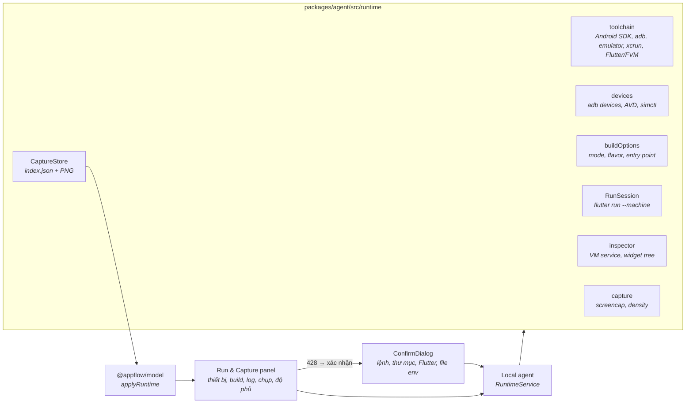

# AppFlow Explorer — Báo cáo Phase 3

20/10/2026

## Tổng quan & phạm vi

Phase 3 hoàn thành ngày 20/10/2026. Với dự án Flutter, AppFlow Explorer giờ build và chạy app trên Android emulator (hoặc iOS simulator khi máy chạy macOS), nhưng chỉ sau khi người dùng xác nhận đúng câu lệnh sẽ chạy. Sau đó AppFlow chụp màn hình thật và gắn ảnh vào các màn hình tìm được bằng phân tích tĩnh. Các chuyển màn hình quan sát được lúc chạy trở thành bằng chứng `runtime`, nhờ đó luồng điều hướng lần đầu có thể đạt trạng thái `verified`.

**Trong phạm vi:**

- Phát hiện emulator và simulator theo khả năng của máy.
- Build và chạy app sau khi được xác nhận, kèm log, retry và báo lỗi.
- Chụp màn hình kèm metadata.
- Gắn ảnh vào màn hình: tự động qua widget tree hoặc chọn thủ công.
- Đo độ phủ: đã chụp hay chưa.
- Hiển thị trên canvas.
- Tài liệu.

**Ngoài phạm vi:**

- Tự bấm qua app (crawler).
- Chụp màn hình runtime cho dự án native Android, iOS và React Native.
- Đóng gói bản cài đặt.

## Quyết định kỹ thuật

| Quyết định | Lựa chọn | Lý do |
| --- | --- | --- |
| Chạy app | `flutter run --machine` | Có sự kiện JSON ổn định (`app.start`, `app.progress`, `app.debugPort`, `app.started`, `app.stop`), nên theo dõi được từng giai đoạn build, cài đặt, chạy và lấy địa chỉ VM service |
| Nhận diện màn hình đang hiển thị | Dart VM service → `ext.flutter.inspector.getRootWidgetTree` (dự phòng `getRootWidgetSummaryTree`) | Đọc được widget tree thật. Màn hình nằm trên cùng là class màn hình đã biết xuất hiện cuối cùng trong cây. Không cần sửa code của dự án |
| Chụp ảnh | `adb exec-out screencap -p`; `wm density` cho pixel ratio; `dumpsys activity` cho activity đang ở foreground; `xcrun simctl io … screenshot` trên macOS | Chỉ đọc màn hình, không tương tác với app |
| Chọn Flutter SDK | `.fvm/flutter_sdk` → `fvm flutter` → `flutter` trên PATH | Dùng đúng phiên bản dự án đã ghim. Nếu phải dùng bản khác thì cảnh báo trong hộp xác nhận |
| iOS | Chỉ khi host là macOS | Không giả định có iOS simulator trên Windows hoặc Linux. Giao diện nói rõ lý do |
| Bằng chứng runtime | Chỉ thêm vào edge khi **đúng một** edge nối hai màn hình vừa quan sát được | Không bao giờ tạo edge mới và không xác minh khi có nhiều khả năng. Nhờ vậy giữ được nguyên tắc "không bịa luồng điều hướng" |
| Lưu trữ | Thư mục dữ liệu của app (`captures/<projectId>/`), không ghi vào dự án | Không làm bẩn repo của người dùng. Ảnh không rời khỏi máy |
| Hiển thị | Lớp phủ `applyRuntime` trên kết quả phân tích gốc, không layout lại | Canvas giữ nguyên vị trí. Xoá ảnh thì màn hình quay về wireframe |

## Kiến trúc

Mọi lệnh đều đi qua một `ProcessRunner`. Tham số được kiểm tra bằng tập ký tự chặt (`[\w@%+=:,./\\-]`). Lệnh không qua shell, trừ `flutter.bat` trên Windows (bắt buộc dùng `cmd`).

## Data model mở rộng

| Thêm mới | Nội dung |
| --- | --- |
| `RuntimeCapture` | Ảnh: kích thước, pixel ratio. Thiết bị: id, tên, nền tảng, OS, độ phân giải, density. Build: mode, flavor, entry point, phiên bản Flutter, lệnh. Thời điểm chụp. Trạng thái điều hướng: các màn hình phát hiện trong cây, màn hình trên cùng, activity. Liên kết: `auto`, `manual` hoặc `none`, kèm lý do |
| `RuntimeObservation` | Một lần chuyển từ màn hình A sang B quan sát được trong một phiên |
| `BuildConfig`, `CaptureDevice` | Kiểu dùng chung cho metadata ở trên |
| `Screenshot.pixelRatio`, `ScreenState.captureId`, `ScreenState.build` | Gắn ảnh thật vào trạng thái màn hình |
| `applyRuntime()` | Thêm state runtime (ảnh mới nhất lên đầu), thêm evidence `runtime` có `observedAt` và độ tin cậy `high` cho edge khớp duy nhất |

## Quy trình chạy & bảo mật

| Yêu cầu | Cách đáp ứng |
| --- | --- |
| Xác nhận rõ ràng | Khởi động emulator, build và chạy app: lần gọi đầu luôn trả `428`. Hộp xác nhận hiện **đúng câu lệnh**, thư mục, nguồn và phiên bản Flutter, cảnh báo, cùng danh sách file env mà build sẽ đọc. Token dùng một lần, hết hạn sau 2 phút, gắn với đúng câu lệnh. Đổi thiết bị, mode, flavor hoặc entry point thì phải xác nhận lại |
| Không chạy gì ngầm | Liệt kê thiết bị, đọc tuỳ chọn build, `flutter --version`, chụp ảnh và đọc widget tree đều chỉ đọc |
| Giữ bí mật | AppFlow không đọc `.env*`. Hộp xác nhận chỉ liệt kê tên file để người dùng biết build sẽ dùng chúng |
| Chỉ tham số hợp lệ | Chỉ nhận mode, flavor (đọc từ `build.gradle(.kts)`) và entry point `lib/main*.dart` mà AppFlow phát hiện được. Dự án có flavor thì bắt buộc chọn |
| Log, lỗi, retry | Log build và chạy được stream vào panel (bộ đệm 3000 dòng). Khi thất bại, panel hiện thông báo kèm các dòng lỗi cuối và nút **Retry build & launch** (phải xác nhận lại). Mỗi dự án chỉ có một phiên chạy |
| Trung thực về độ phủ | Panel hiện "N of M discovered screens captured" và danh sách **Not captured yet**. App khởi động được không có nghĩa là đã chụp màn hình nào. Ảnh không nhận diện được màn hình thì để `unassigned` và ghi rõ lý do |

Rủi ro khi build (chạy script Gradle/Podfile, gọi backend thật, cần signing khi build release) và các bước kiểm tra được ghi trong [runtime-capture.md](runtime-capture.md).

## Tích hợp giao diện

- **Tab Run & Capture** (panel phải, có với dự án Flutter đã phân tích):
  - **Device:** danh sách thiết bị kèm trạng thái và nút Start cho emulator đang tắt. Panel ghi chú khi không chạy được iOS và liệt kê phần còn thiếu trên máy.
  - **Build:** nguồn và phiên bản Flutter, mode, flavor, entry point; nút Build & launch…, Retry, Stop app.
  - **Session:** trạng thái, giai đoạn, lỗi và log.
  - **Capture:** chọn màn hình để gắn (Assign to), nút **Capture current screen**, công tắc **Auto-capture** (người dùng tự điều hướng, mỗi màn hình mới ổn định khoảng 1,5 giây thì được chụp một lần).
  - **Coverage:** lưới ảnh; mỗi ảnh có thể gắn lại, bỏ gắn hoặc xoá.
- **Canvas:** màn hình có ảnh thật hiện screenshot kèm nhãn xanh **Captured**. Màn hình chưa có ảnh giữ wireframe "Not captured yet". Edge có bằng chứng runtime chuyển sang **Verified** (nét liền xanh dương).
- **ConfirmDialog:** dùng chung cho mọi thao tác cần xác nhận.

## Kiểm thử & xác minh

Cả 172 test đều pass, typecheck sạch, build production thành công.

| Bộ test | Số test | Thêm trong Phase 3 |
| --- | --- | --- |
| `packages/model` | 10 | `applyRuntime`: thêm state, chỉ xác minh edge khớp duy nhất, bỏ qua quan sát mơ hồ |
| `packages/analyzer` | 97 | Giữ nguyên, cùng các bản sửa lỗi sau Phase 2 (AutoRoute, class trùng tên…) |
| `packages/agent` | 35 | 14 test runtime với toolchain giả: phát hiện host và thiết bị, xác nhận khi boot, tuỳ chọn build, vòng đời phiên, chụp, gắn, xoá, ảnh, dừng, lỗi rồi retry, validate |
| `apps/desktop` | 30 | `runtimeStore`: luồng 428 → xác nhận, chạy, poll, chụp, gắn |

**Kiểm tra end-to-end với công cụ thật** (Windows 11, emulator Pixel 6a Android 17, Flutter 3.44.9). Kiểm tra chạy trên app mẫu `capture_demo` do mình tạo (2 màn hình), **không phải** dự án của bạn:

| Bước | Kết quả |
| --- | --- |
| Xác nhận | `428` hiện lệnh `flutter.bat run --machine -d emulator-5554 --debug -t lib/main.dart` |
| Build và chạy | `assembleDebug` → cài APK → `✔ App started` sau khoảng 1,5 phút; trạng thái `running`, có VM service |
| Nhận diện | `{"detected":["HomeScreen"],"top":"HomeScreen"}` |
| Chụp | Tự gắn vào `HomeScreen`, ảnh 1080×2400, pixel ratio 2.625, build debug, Flutter 3.44.9 |
| Auto-capture | App chuyển sang Details → tự chụp `DetailsScreen` (auto) và ghi nhận chuyển cảnh `HomeScreen → DetailsScreen` |
| Canvas | Hai màn hình hiện ảnh thật với nhãn Captured, edge chuyển sang **Verified**, Coverage "2 of 2" (kiểm tra bằng ảnh chụp cửa sổ app thật) |
| Dừng | `app.stop` → trạng thái `stopped` |

Trên dự án `htp_loyalty-app`, mình mới chỉ chạy các thao tác chỉ đọc. Kết quả: phát hiện emulator; nhận đúng 3 flavor `development`, `staging` và `production`; dùng SDK FVM 3.38.9 của dự án, khớp `.fvmrc`; liệt kê `.env.*` là input của build. **Chưa build hay chạy dự án này** vì việc đó cần bạn đồng ý.

## Hạn chế đã biết & bước tiếp theo

- Không có crawler: người dùng tự điều hướng, AppFlow chụp. Màn hình nằm sau đăng nhập hoặc cần dữ liệu cụ thể phụ thuộc vào người dùng.
- Nhận diện màn hình chỉ hoạt động với bản debug do AppFlow khởi chạy. Ảnh từ bản profile, release hoặc app chạy bên ngoài phải gắn thủ công.
- Detector chỉ biết các class màn hình mà phân tích tĩnh tìm ra. Màn hình runtime chưa được phát hiện thì để unassigned.
- Màn hình con trong một màn hình (tab, `BodyContent`) được tính theo class màn hình ngoài cùng nằm trên cùng của cây.
- Flavor iOS giả định Xcode scheme trùng tên với flavor Android (quy ước của Flutter). Đường iOS chưa được chạy thật vì máy này là Windows.
- Lần build đầu có thể lâu (tải Gradle và pub). Không có timeout cứng, người dùng tự Stop.

**Bước tiếp theo đề xuất:**

1. Chạy thử trên `htp_loyalty-app` với flavor `development` sau khi bạn đồng ý.
2. Hỗ trợ runtime capture cho Android native và React Native.
3. Xuất bản đồ cùng ảnh chụp (PNG/PDF).
4. Đóng gói bản cài đặt.

**Cách chạy:** `npm install`, sau đó `npm run dev`. Mở dự án Flutter → tab **Run & Capture** → chọn thiết bị → **Build & launch…** → xác nhận → **Capture current screen** hoặc bật **Auto-capture** rồi tự điều hướng trong emulator.
