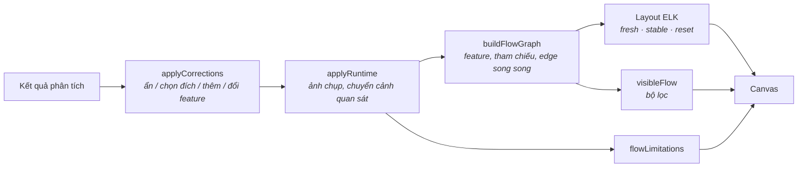

# AppFlow Explorer — Báo cáo Phase 4

20/10/2026

## Tổng quan & phạm vi

Phase 4 hoàn thành ngày 20/10/2026. App Flow Map giờ được dựng tự động từ hai nguồn: phân tích tĩnh và các chuyển màn hình quan sát được lúc chạy app. Bản đồ gom màn hình theo feature và vẽ một lần những điểm đến dùng chung (như Login). Người dùng có thể lọc bản đồ, sửa graph bằng tay, và giữ nguyên layout khi phân tích lại. Mỗi đường nối ghi rõ nguồn gốc. Những gì phân tích không biết được thì liệt kê ra, không đoán.

**Trong phạm vi:**

- Graph gồm màn hình và trạng thái UI, với provenance của từng edge.
- Nhánh, dialog, bottom sheet, điểm đến lặp lại và edge song song.
- Gom nhóm theo feature.
- Auto layout, fit, zoom, pan, kéo thả màn hình hoặc cả nhóm, chọn edge.
- Bộ lọc.
- Sửa graph thủ công.
- Giảm chồng lấn và giao cắt.
- Layout ổn định khi phân tích lại.
- Bảng "What this map does not know".
- Test và tài liệu.

**Ngoài phạm vi:**

- Tự động bấm qua app (crawler).
- Đồng bộ correction giữa nhiều máy hoặc nhiều người: correction được lưu cục bộ.
- Xuất bản đồ ra file.

## Quyết định kỹ thuật

| Quyết định | Lựa chọn | Lý do |
| --- | --- | --- |
| Chuỗi dựng bản đồ | Kết quả phân tích → `applyCorrections` → `applyRuntime` → `buildFlowGraph` → layout / `visibleFlow` / `flowLimitations` | Mỗi bước là hàm thuần, không sửa kết quả phân tích. Cả chuỗi chạy lại khi phân tích lại, khi sửa graph hoặc khi có ảnh chụp mới |
| Trạng thái mới `manual` | Bằng chứng nguồn `manual`; thứ tự ưu tiên runtime → manual → declared → static | Sửa tay được hiển thị riêng (nét xanh ngọc, nhãn "Set by you"), không bao giờ được tính là verified |
| Chuyển cảnh quan sát được nhưng không có trong code | Thêm edge "Observed at runtime", trigger ghi là không rõ | Đây là quan sát thật nên không phải bịa. Phase 3 bỏ qua trường hợp này. Nếu nhiều edge cùng khớp thì không xác minh edge nào, và ghi vào danh sách giới hạn |
| Điểm đến dùng chung | Màn hình được ≥ 4 màn hình khác dẫn tới chỉ vẽ một lần; các đường còn lại trỏ tới node tham chiếu "↪ Tên màn hình" | Giảm nhiều đường dài cắt ngang bản đồ. Đường thật được giữ cho màn hình gần màn hình start nhất |
| Nhận diện feature | Theo thư mục: thư mục sau `features/`, `pages/`, `screens/`, `presentation/`…; thư mục dialog, bottom sheet, widget dùng chung gom thành một nhóm riêng | Không cần cấu hình. Sửa được cho từng màn hình. Feature chỉ có một màn hình thì không vẽ khung |
| Layout | ELK layered có compound node cho feature; input được sắp xếp nên cùng graph luôn cho cùng hình | Các màn hình của một feature nằm cạnh nhau, giảm giao cắt |
| Khi phân tích lại | Mọi node còn tồn tại giữ nguyên vị trí; node mới đặt cạnh hàng xóm rồi đẩy xuống cho hết chồng | Bản đồ không bị nhảy sau mỗi lần sửa code |
| Lưu correction | `localStorage` theo từng dự án, tách khỏi kết quả phân tích; correction của edge unresolved khớp theo màn hình, file, handler và nhãn, không theo số dòng | Correction vẫn đúng khi lời gọi điều hướng dịch sang dòng khác |
| Fit view | Tính khung bao từ vị trí layout và kích thước node đã biết | Không phụ thuộc thời điểm React Flow đo xong node (lỗi tìm được khi chạy trên dự án thật) |

## Kiến trúc



```
packages/model/src/flow.ts        corrections, feature, flow graph, filters, limitations
packages/model/src/graph.ts       edgeStatus (+manual), applyRuntime (+observed-only), ambiguousObservations
apps/desktop/.../canvas/          layout.ts (compound, stabilizeLayout, resolveOverlaps), GroupNode, AliasNode,
                                  NavEdge (song song), CanvasControls (Filters), LimitationsPanel, useFitAll
apps/desktop/.../components/      Corrections.tsx (sửa graph), DetailsPanel
apps/desktop/.../store/           explorerStore: derive(), layout theo chế độ, actions sửa graph và lọc
```

## Đáp ứng yêu cầu

| Yêu cầu | Cách đáp ứng |
| --- | --- |
| Gộp tĩnh và runtime | `applyRuntime` gắn bằng chứng runtime vào edge khớp duy nhất, thêm edge chỉ-quan-sát, ghi lại quan sát mơ hồ |
| Màn hình và trạng thái UI | Node màn hình có nút chuyển ‹ 1/3 › khi có nhiều trạng thái (nhiều ảnh chụp); màn hình chưa chụp giữ wireframe |
| Edge có hướng, ghi tên hành động | Nhãn lấy từ trigger (ví dụ `onTap · ItemTicketPromotion`); edge chỉ-quan-sát ghi "Observed at runtime" |
| Phân biệt inferred và runtime | 5 kiểu nét, legend chỉ hiện loại có trong dự án, badge và bằng chứng trong panel |
| Nhánh, dialog, bottom sheet, điểm đến lặp lại | Edge song song được tách đường và nhãn; dialog và sheet có khung nét đứt; điểm đến dùng chung vẽ một lần |
| Gom theo feature | Khung feature kéo được bằng tiêu đề; có thể bật hoặc tắt |
| Auto layout, fit, zoom, pan, kéo thả, chọn edge | Có từ Phase 1, nay hỗ trợ thêm nhóm, node tham chiếu và fit chính xác |
| Bộ lọc | Theo trạng thái, loại màn hình, feature, ẩn màn hình không còn kết nối; lọc không làm thay đổi layout |
| Sửa graph thủ công | Đánh dấu sai (ẩn), chọn đích cho edge unresolved, thêm edge, đổi feature; khôi phục và xoá trong Overview |
| Giảm chồng lấn và giao cắt | ELK crossing minimization, compound theo feature, node tham chiếu cho điểm đến dùng chung, `resolveOverlaps` |
| Giữ layout khi phân tích lại | `stabilizeLayout`; vị trí đã kéo được lưu qua các lần khởi động |
| Không bịa quan hệ | Đích không rõ hiện "Unknown destination"; quan sát mơ hồ không xác minh edge nào; correction không còn khớp được báo, không âm thầm áp dụng |

## Kiểm thử & xác minh

Cả 200 test đều pass, typecheck sạch, build production thành công.

| Bộ test | Số test | Thêm trong Phase 4 |
| --- | --- | --- |
| `packages/model` | 28 (+18) | Dựng graph (node, nhánh, dialog, edge song song, điểm đến dùng chung, feature, không phụ thuộc thứ tự input); provenance của edge; correction (ẩn, chọn đích, thêm, đổi dòng, correction cũ); bộ lọc; danh sách giới hạn; runtime overlay |
| `apps/desktop` | 40 (+10) | Layout: đủ node, không chồng, start ở cột đầu, các feature tách nhau, kết quả cố định, giữ vị trí khi phân tích lại. Store: phân tích lại vẫn giữ correction và vị trí, correction lưu qua phiên, correction cũ, lọc không layout lại, edge chỉ-quan-sát |
| `packages/analyzer` | 97 | Không đổi |
| `packages/agent` | 35 | Không đổi |

**Kiểm tra trên app thật** (chụp cửa sổ Electron):

- **`htp_loyalty-app`:** 50 màn hình và 74 flow. Bản đồ chia nhóm Auth (7), Bottom sheets (9), Dialogs (5), Voucher (5), QR scan (4)…, có 15 node tham chiếu cho điểm đến dùng chung. Fit hiển thị trọn bản đồ. Bảng giới hạn ghi "74 of 74 flow(s) … have not been observed in the running app" và "4 screen(s) have no incoming navigation found".
- **Demo ShopLite:**
  - Chọn đích cho một điều hướng unresolved thì edge chuyển sang "Set by you" và panel ghi rõ "not verified".
  - Hai edge Home → Search được tách nhãn riêng.
  - Bảng giới hạn có thêm "1 flow(s) were added or completed by hand".

**Lỗi tìm và sửa trong quá trình kiểm tra:**

- ELK compound layout lỗi khi bật `considerModelOrder`. Đã chỉ dùng option này cho layout không nhóm.
- Fit tự động không ổn định vì phụ thuộc thời điểm đo node. Đã chuyển sang tính khung bao từ vị trí layout.
- Vị trí vừa kéo bị layout đang chạy ghi đè. Đã sửa để đọc vị trí đã ghim lúc layout kết thúc.
- `applyRuntime` xoá cả bằng chứng runtime có sẵn. Đã sửa để chỉ xoá phần nó tự thêm.

## Hạn chế đã biết & bước tiếp theo

- Với dự án lớn, bản đồ khá cao và hẹp: nhóm không có edge nội bộ (Dialogs, Bottom sheets) xếp thành một cột.
- Nhận diện feature dựa vào quy ước thư mục. Dự án tổ chức theo layer (`data/`, `domain/`, `ui/`) sẽ cần đổi feature bằng tay.
- Correction lưu trong `localStorage` của app trên máy này, chưa xuất hoặc chia sẻ được.
- Màn hình thấy lúc chạy nhưng phân tích tĩnh không tìm ra vẫn không thành node (kế thừa giới hạn của Phase 3).

**Bước tiếp theo đề xuất:**

1. Xếp lưới cho các nhóm không có edge nội bộ.
2. Xuất bản đồ (PNG/PDF/JSON) kèm correction.
3. Lưu correction cạnh dữ liệu capture trong thư mục dữ liệu của agent để chia sẻ được.
4. Chạy runtime capture trên `htp_loyalty-app` (cần bạn đồng ý).

**Cách dùng:** mở dự án → bản đồ tự dựng. Nút **Filters** ở thanh dưới để lọc hoặc đổi cách sắp xếp. Chọn màn hình hoặc edge → **Correct the map** ở panel phải để sửa. Bấm **What this map does not know** ở giữa phía dưới để xem giới hạn. Chi tiết ở [flow-map.md](flow-map.md).
